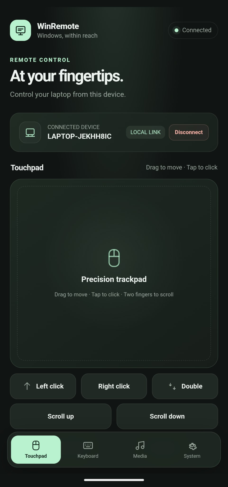
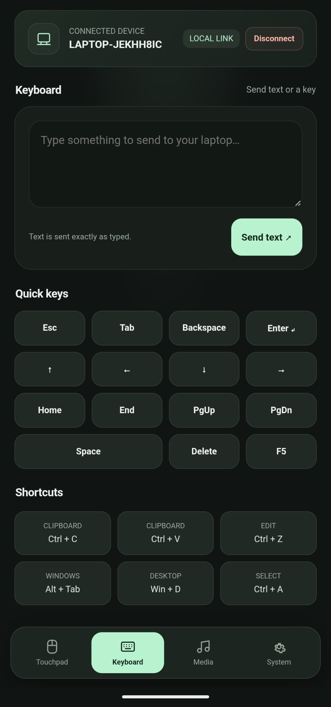
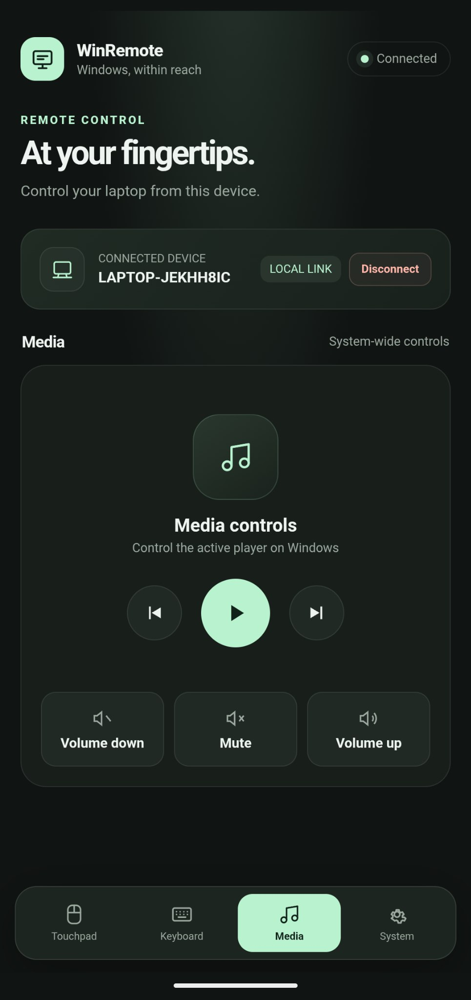
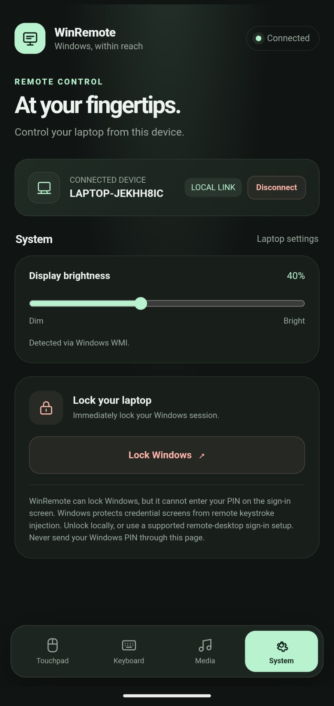
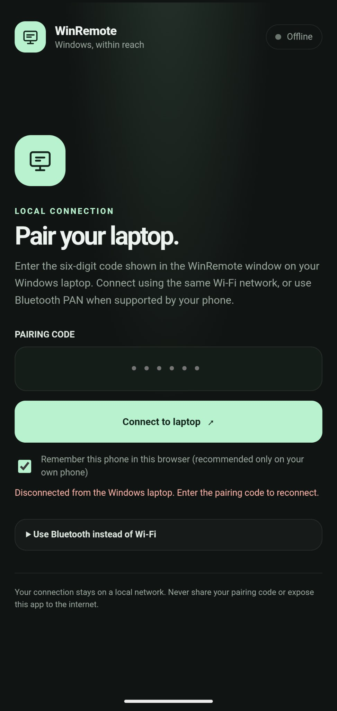
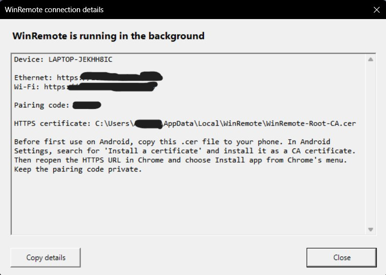
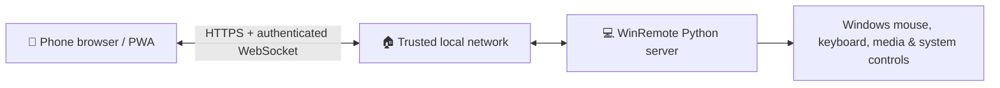

# WinRemote

### Windows, within reach.

**Turn your phone into a wireless touchpad, keyboard, media controller, and more for your Windows PC.**

A lightweight, open-source remote control that works in your phone's browser over your **local network**. No separate mobile app or cloud account required.

[**Download**](https://github.com/ananyenonu/WinRemote/releases/latest) · [**Get started**](#quick-start) · [**Features**](#features) · [**Security**](#security) · [**Contribute**](CONTRIBUTING.md)

---

## See it in action

<table>
  <tr>
    <td align="center"> <b>Touchpad</b></td>
    <td align="center"> <b>Keyboard</b></td>
    <td align="center"> <b>Media</b></td>
  </tr>
</table>

<table>
  <tr>
    <td align="center"> <b>System</b></td>
    <td align="center"> <b>Pairing</b></td>
  </tr>
</table>

*The actual WinRemote mobile interface. Appearance may differ slightly across devices.*

## Features

| | Feature | What it does |
|---|---|---|
| 🖱️ | **Precision touchpad** | Move the pointer, tap to click, use left/right-click buttons, and scroll. |
| ⌨️ | **Remote keyboard** | Send text, use quick keys, arrows, and common Windows shortcuts. |
| 🎵 | **Media controls** | Play/pause, skip tracks, mute, and change system volume. |
| ☀️ | **Display brightness** | Adjust brightness when the Windows display exposes supported controls. |
| 🖥️ | **Desktop shortcuts** | Switch virtual desktops using dedicated controls. |
| 🔒 | **Lock Windows** | Lock your active Windows session remotely. |
| 📱 | **Installable PWA** | Add WinRemote to your Android home screen from a compatible browser. |
| 🔐 | **Device pairing** | Six-digit pairing, session authentication, and optional remembered devices. |
| 🏠 | **Local-first** | Connect over a trusted Wi-Fi/Ethernet network; supported Bluetooth PAN setups may also work. |
| 🚀 | **Background startup** | Windows shortcuts make it easy to start, stop, and inspect the server. |

> [!NOTE]
> WinRemote is a **local input controller**, not a screen-sharing or full remote-desktop application. It cannot unlock the Windows sign-in screen.

## Quick start

### Requirements

- **PC:** Windows 10 or Windows 11
- **Python:** 3.10 or newer, available to the installer
- **Phone:** Android with a compatible browser (Chrome recommended for PWA installation)
- **Network:** Phone and PC on the same trusted local network. Wi-Fi is recommended.

### 1. Download and install on Windows

1. Go to the [latest release](https://github.com/ananyenonu/WinRemote/releases/latest) and download **Source code (zip)**.
2. Extract the **entire** folder to a permanent location, such as `Documents\WinRemote`. Avoid moving the folder after setup.
3. Double-click **`Install WinRemote.bat`**. This installs Python dependencies, creates shortcuts, configures background startup at Windows sign-in, and launches WinRemote.
4. Open **WinRemote connection details** on the PC to see the HTTPS address, pairing code, and certificate location.

> [!IMPORTANT]
> The ZIP is a **source distribution**. There is not yet a standalone `.exe` installer; Python is required.

### 2. Trust your own local certificate on Android

WinRemote serves the interface over HTTPS using a certificate generated locally on **your own PC**. Before first use:

1. On Windows, find the `WinRemote-Root-CA.cer` file shown in the connection-details window (normally under `%LOCALAPPDATA%\WinRemote`).
2. Transfer **only the `.cer` public certificate** to your phone. **Never transfer or share the CA private key.**
3. On Android, open **Settings**, search for **Install a certificate**, and install it as a **CA certificate**. Exact menu names vary by Android version and manufacturer.
4. Open the HTTPS address shown by WinRemote in Chrome. If you still see a certificate warning, **do not bypass it**; recheck the certificate and address.

> [!WARNING]
> Installing a CA certificate changes what your phone trusts. Install **only the CA certificate generated by your own WinRemote installation**, never one supplied by a stranger. Remove it when you no longer use WinRemote.

### 3. Pair your phone

1. Open the PC's WinRemote HTTPS URL on your phone.
2. Enter the **six-digit pairing code** shown on the Windows connection-details screen.
3. Select **Connect to laptop**.
4. Optionally enable **Remember this phone** only on a device you personally control.
5. In Chrome, use **Install app** from the menu to add WinRemote to your home screen.

*The Windows connection-details window. Network addresses and pairing code are redacted in this example.*

## Using WinRemote

| Control | Gesture / action |
|---|---|
| Move cursor | Drag one finger across the touchpad |
| Left click | Tap touchpad or use **Left click** |
| Right click | Use **Right click** |
| Scroll | Two-finger gesture where supported, or **Scroll up/down** buttons |
| Send text | Open **Keyboard**, enter text, select **Send text** |
| Shortcuts | Use quick keys such as `Ctrl+C`, `Ctrl+V`, `Alt+Tab`, or `Win+D` |
| Media | Use the **Media** tab for playback and volume |
| Brightness / lock | Open the **System** tab |
| Virtual desktops | Use the provided previous/next desktop controls |

### How it works

**Technology:** Python, `aiohttp`, WebSockets, HTML, CSS, JavaScript, Windows APIs, and Progressive Web App features.

## Security

WinRemote can send mouse and keyboard input to your signed-in Windows desktop. **Only run it on a network and devices you trust.**

- Uses HTTPS with a locally generated CA and a six-digit pairing flow.
- Supports authenticated sessions and optional remembered devices.
- Applies throttling to pairing attempts.
- **Never** port-forward the WinRemote port (default `8765`) or expose it to the public internet.
- Keep pairing codes, session tokens, private keys, and runtime data private.
- **Lock Windows** works, but WinRemote **cannot enter your Windows PIN on the sign-in screen**.
- Do not run WinRemote as Administrator unless strictly necessary.
- If a remembered phone is lost, revoke remembered-device access by removing `%LOCALAPPDATA%\WinRemote\trusted_devices.json` while WinRemote is stopped, then restart the server.

See [SECURITY.md](SECURITY.md) for vulnerability reporting and deployment guidance.

## Troubleshooting

<b>My phone cannot connect</b>

Check that WinRemote is running, both devices are on the same trusted local network, and the displayed IP address is current. Some guest Wi-Fi networks block communication between devices. If Windows Firewall blocks the server, permit the relevant Python process on **Private networks only**, not Public.

<b>Chrome shows an HTTPS / certificate warning</b>

Check that you installed the `.cer` generated by **this Windows installation** and that the connection URL matches the current PC address. Do not bypass certificate warnings.

<b>The bookmarked URL stopped working</b>

Your PC may have received a different IP address from your router. Open **Show connection details** again, or configure a DHCP reservation on your router for a stable address.

<b>Brightness is unavailable</b>

Brightness requires Windows to expose a supported monitor control. Try **Diagnose Brightness.bat**. External monitors may require DDC/CI support, if available. After upgrading, rerun **Install WinRemote.bat** to refresh dependencies.

<b>WinRemote doesn't start</b>

Check `%LOCALAPPDATA%\WinRemote\launcher-error.log` and `server.log`. You can use the included start/stop shortcuts to restart the server.

<b>Can I use Bluetooth?</b>

Some Windows/Android setups support **Bluetooth PAN**, which provides a local network connection over Bluetooth. WinRemote is **not** a direct Bluetooth HID keyboard or mouse. Wi-Fi is more broadly supported.

## Roadmap

Ideas for future development (not promises or currently supported features):

- [ ] Simplified Windows installer that does not require a separate Python setup
- [ ] More approachable certificate onboarding
- [ ] Automated tests and CI
- [ ] Additional device compatibility testing
- [ ] Expanded customization and accessibility options

Have an idea? [Open an issue](https://github.com/ananyenonu/WinRemote/issues).

## Contributing

Contributions, bug reports, and documentation improvements are welcome. Please read [CONTRIBUTING.md](CONTRIBUTING.md) before submitting changes. For security issues, follow [SECURITY.md](SECURITY.md) instead of posting exploit details publicly.

## License

Distributed under the [MIT License](LICENSE).

**Made for a simpler way to control Windows.**

[⭐ Star the repository](https://github.com/ananyenonu/WinRemote) · [Report a bug](https://github.com/ananyenonu/WinRemote/issues/new) · [View releases](https://github.com/ananyenonu/WinRemote/releases)

